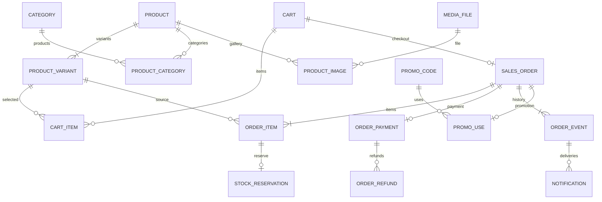

# Microshop: схема данных

## Статус и границы

Схема PostgreSQL для первого рабочего релиза. Источники требований: [концепция](CONCEPT.md) и [поставка](DELIVERY.md). Документ определяет таблицы, связи, ограничения и границы транзакций; SQL-миграции и код приложения пока не реализованы.

Подтвержденные правила: одна установка обслуживает один магазин; валюта — RUB; цены задаются вариантом; покупателю не нужна регистрация; заказ сохраняет снимки данных; резерв создается при checkout. Складской товар списывается при отправке или выдаче. Использование промокода учитывается при создании заказа и освобождается при отмене без положительной ручной оплаты, включая заказ с `ZERO_TOTAL`. Персональный лимит определяется по телефону или email, выбранному продавцом у промокода.

Первый рабочий релиз использует общую галерею с фотографиями вариантов, заранее заданную цену `CUSTOM`, скидку промокода только на подходящие товары и автоматический `PAID` при нулевом итоге. Эти правила описаны ниже и в концепции; они не означают, что поведение уже реализовано. Возможные расширения отделены от правил MVP в последнем разделе.

В MVP не включаются таблицы аккаунтов покупателей, CRM, рассылок, нескольких складов, платежных провайдеров или нескольких магазинов. CSV-экспорт и dashboard используют торговые таблицы без отдельного хранилища аналитики.

## Общие соглашения

| Область | Решение |
|---|---|
| Идентификаторы | `uuid`; генерируются backend; сами по себе не предоставляют доступ |
| Время | `timestamptz`; хранится момент времени, отображение учитывает часовой пояс магазина |
| Деньги | `bigint` в копейках; неотрицательные значения; расчеты с проверкой переполнения |
| Количество | `integer`; остаток неотрицателен, количество позиции строго положительно |
| Перечисления | `text` с `CHECK` на допустимые значения |
| Необязательные поля | Помечены `?`; остальные — `NOT NULL` |
| JSON | `jsonb` только для структур со схемой валидации: характеристики, адреса, снимки, настройки, события |
| Удаление | Торговые справочники архивируются; исторические связи не удаляются каскадно |
| Мультитенантность | `shop_id` в торговых таблицах отсутствует; настройки магазина — одна строка |

У всех самостоятельных сущностей `id` — первичный ключ, если не указано другое. `created_at` и `updated_at` имеют тип `timestamptz`. Для неизменяемых записей достаточно времени создания. В таблицах связей используются составные первичные ключи.

Все перечисленные внешние ключи создаются в БД. По умолчанию удаление родителя запрещено (`RESTRICT`); исключения для зависимых записей описаны явно. Индексы внешних ключей создаются для связей, по которым выполняются выборки или проверки удаления.

### JPA и миграции

- Доступ к данным реализуется через Spring Data JPA с Hibernate. Простые операции
  используют стандартные методы репозиториев; явные выборки — `@Query` с JPQL
  или native SQL для возможностей PostgreSQL.
- Схему создают и изменяют только SQL-миграции Flyway. Hibernate запускается
  с `ddl-auto=validate`; автоматическое создание или обновление схемы отключено.
  Ошибка миграции или проверки маппинга исключает готовность приложения.
- Внешние ключи, `CHECK`, уникальные ограничения и индексы сохраняются в БД.
  JPA-аннотации не заменяют эти ограничения. Cascade REMOVE и orphan removal
  не применяются к сохраняемой торговой истории; допустимое удаление связей,
  корзин и файлов следует правилам этого документа.
- Транзакционная граница задается на уровне бизнес-операции. Режим изоляции
  и порядок блокировок определены в разделе «Транзакционные правила».
  `@Lock` используется для блокируемых выборок сущностей; native SQL — там,
  где требуется точный запрос PostgreSQL, включая `SKIP LOCKED`.
- Open EntityManager in View отключен (`spring.jpa.open-in-view=false`).
  API возвращает DTO, а необходимые связи загружаются внутри транзакции по
  явному плану выборки. При получении списков связанные данные загружаются
  группой, без отдельного запроса на каждый элемент.
- Изменяющие запросы `@Modifying @Query` не должны оставлять устаревшие
  сущности для последующего сохранения. Перед прямым изменением БД сохраняются
  ожидающие изменения JPA; после него затронутые сущности обновляются из БД
  или исключаются из persistence context до дальнейшей работы с ними.
- После ожидания блокировки проверяются актуальные данные. Суммы резервов
  и использования промокода читаются отдельными запросами после захвата
  соответствующей строки; ранее загруженные коллекции не используются
  как источник актуальных остатков или лимитов.

## Карта связей

Диаграмма показывает основные торговые связи. Дополнительные внешние ключи, включая настройки, справочники, файлы снимков и административного пользователя, определены в соответствующих таблицах ниже.

## Магазин и административный доступ

### `installation_state`

Одна строка, которая обеспечивает атомарный первый запуск.

| Поле | Тип | Назначение |
|---|---|---|
| `id` | `smallint` | PK, `CHECK (id = 1)` |
| `status` | `text` | `UNINITIALIZED`, `INITIALIZED` |
| `setup_token_hash` | `bytea?` | Хеш одноразового setup-token |
| `owner_admin_id` | `uuid?` | FK → `admin_user.id` |
| `initialized_at` | `timestamptz?` | Время создания владельца |

В состоянии `UNINITIALIZED` владелец и время отсутствуют, хеш token задан. В `INITIALIZED` владелец и время обязательны, хеш удален. Согласованность полей проверяет `CHECK`.

Первичная строка создается из установочной конфигурации без сохранения открытого token в БД. Повторный старт не сбрасывает ее. Создание владельца блокирует эту строку и одной транзакцией создает `admin_user`, удаляет хеш token и переводит установку в `INITIALIZED`.

### `admin_user`

| Поле | Тип | Назначение |
|---|---|---|
| `id` | `uuid` | PK |
| `login` | `text` | Нормализованный уникальный логин |
| `password_hash` | `text` | Хеш пароля в формате выбранного механизма авторизации |
| `display_name` | `text` | Имя владельца |
| `enabled` | `boolean` | Разрешен ли вход |
| `created_at`, `updated_at` | `timestamptz` | Время изменений |

Первый и единственный пользователь MVP — владелец. Отдельные таблицы ролей и разрешений не требуются. Создание дополнительных пользователей через API отсутствует.

### Административные сессии: Spring Session JDBC

HTTP-сессии хранит Spring Session JDBC в общей PostgreSQL. Они сохраняются
при перезапуске backend и используются Spring Security для административного
доступа. Собственная таблица `admin_session` не создается.

Используется стандартная [схема Spring Session для PostgreSQL](https://docs.spring.io/spring-session/reference/configuration/jdbc.html).
Имена таблиц в PostgreSQL — `spring_session` и `spring_session_attributes`.
Это служебные таблицы библиотеки: общие соглашения о доменных UUID и
`timestamptz` к ним не применяются. Они не отображаются в JPA-сущности.

| Таблица | Поля и назначение |
|---|---|
| `spring_session` | `primary_id char(36)` — PK; `session_id char(36)` — уникальный идентификатор сессии; `creation_time`, `last_access_time`, `expiry_time bigint` — время в миллисекундах Unix; `max_inactive_interval integer` — срок неактивности в секундах; `principal_name varchar(100)?` — идентификатор владельца |
| `spring_session_attributes` | `session_primary_id char(36)` — FK → `spring_session.primary_id` с `ON DELETE CASCADE`; `attribute_name varchar(200)`, `attribute_bytes bytea` — атрибуты сессии; PK `(session_primary_id, attribute_name)` |

Flyway создает таблицы и индексы по PostgreSQL-скрипту выбранной версии
Spring Session. Автоматическая инициализация схемы Spring Session отключается
через `spring.session.jdbc.initialize-schema=never`. Изменения служебной схемы
при обновлении библиотеки также оформляются миграциями.

Идентификатор сессии хранится в БД без хеширования и передается браузером
в cookie с `HttpOnly`, `Secure` и `SameSite=Lax`. CSRF-token хранится как
атрибут HTTP-сессии через `HttpSessionCsrfTokenRepository`; изменяющие запросы
admin UI передают его в заголовке и проверяются штатным CSRF-фильтром
Spring Security. Отдельных полей хешей session-token и CSRF-token нет.

Principal содержит стабильный id владельца; `principal_name` использует его
строковое представление. В сессию не сохраняются JPA-сущности, пароли и
их хеши. Связь с `admin_user` проверяет приложение: FK из служебных таблиц
не добавляется. Каждый административный запрос проверяет актуальный
`admin_user.enabled`, а не только сохраненное состояние principal.

Spring Session проверяет истечение срока неактивности и очищает истекшие
сессии. Logout инвалидирует сессию; принудительный отзыв удаляет ее через
репозиторий Spring Session. Исторические торговые записи ссылаются на
пользователя, а не на сессию. Cookie, идентификаторы сессий и CSRF-token
исключаются из журналов и audit. Конкретный timeout и контракт получения
CSRF-token определяются при проектировании MS-02.

### `shop_settings`

Одна строка с PK `id = 1` (`smallint`).

| Поле | Тип | Назначение |
|---|---|---|
| `name`, `description` | `text` | Название и описание; до настройки допустимы пустые строки |
| `contacts` | `jsonb` | Контакты продавца: телефон, email, Telegram, другой контакт |
| `logo_file_id` | `uuid?` | FK → `media_file.id`; необязательный логотип витрины |
| `primary_color`, `background_color` | `text?` | Необязательные цвета витрины в формате `#RRGGBB` |
| `sales_terms` | `text` | Условия продажи |
| `checkout_contact_rules` | `jsonb` | Обязательные контакты при оформлении |
| `published` | `boolean` | Прошел ли магазин публикацию |
| `sales_enabled` | `boolean` | Разрешено ли оформление заказов |
| `sales_disabled_reason` | `text?` | Сообщение покупателю при приостановке |
| `timezone` | `text` | Часовой пояс для дат и статистики; начальное значение `Europe/Moscow` |
| `notification_settings` | `jsonb` | Включенные каналы, адрес продавца, параметры подключений |
| `updated_at` | `timestamptz` | Время изменения |

Для правил контактов используется ограниченная структура, например `{"required":["name"],"any_of":[["phone","telegram"]]}`: имя обязательно, дополнительно нужен хотя бы один контакт из группы. Если групп несколько, выполняется каждая группа. Обязательны два массива `required` и `any_of`; пустые массивы допустимы, каждая указанная группа непустая. Допустимые ключи: `name`, `phone`, `email`, `telegram`, `other_contact`; неизвестные поля, повтор ключа внутри массива или группы и произвольные выражения не поддерживаются. Настройки определяют обязательность контактов, а не подменяют валидацию переданных значений.

До публикации `published = false`, `sales_enabled = false`. Условия публикации
заданы в разделе «Публикация магазина» CONCEPT.md: владелец создан, название,
контакт продавца и условия продажи заполнены, правила контактов валидны и
существует совместимая пара включенных неархивных способов оплаты и получения.
Для `CASH_ON_PICKUP` подходит только `PICKUP`; остальные способы используют
согласованные требования предоплаты и доставки. Наличие товара не проверяется
как условие публикации. Поля `published` и `sales_enabled` независимы;
`sales_enabled = false` после публикации не скрывает каталог. Новый checkout
повторно проверяет готовность торговых настроек. Валюта не является настройкой
и в таблице не хранится.

Название, описание и контакты не дублируются в отдельных настройках витрины.
`logo_file_id` ссылается на проверенный файл изображения; файл нельзя удалить,
пока он используется как логотип. `NULL` означает отсутствие пользовательского
логотипа. Цвета при наличии валидируются как шестизначный RGB-код и приводятся
к верхнему регистру; `NULL` означает стандартный цвет поставляемой витрины.
Шрифт, hero, социальные ссылки и переключатели отображения не хранятся
как отдельные настройки MVP.

Установочные secrets остаются в конфигурации поставки. Параметры подключений
уведомлений редактируются через admin API и хранятся в `notification_settings`
по формату раздела «Настройки каналов» ниже. Bot token и пароль SMTP сохраняются
зашифрованными; открытые значения исключаются из ответов, audit и журналов.

## Каталог и файлы

### `product`

| Поле | Тип | Назначение |
|---|---|---|
| `id` | `uuid` | PK |
| `name` | `text` | Непустое название |
| `slug` | `text` | Уникальная нормализованная часть URL |
| `description` | `text` | Описание |
| `status` | `text` | `DRAFT`, `ACTIVE`, `HIDDEN`, `ARCHIVED` |
| `sort_order` | `integer` | Порядок на витрине |
| `created_at`, `updated_at` | `timestamptz` | Время изменений |

Slug автоматически создается из названия, допускает редактирование и сохраняется при переименовании. Уникальность распространяется на архивные записи. Для публикации нужен хотя бы один неархивный вариант. Проверка числа вариантов выполняется транзакционно приложением.

### `product_variant`

| Поле | Тип | Назначение |
|---|---|---|
| `id` | `uuid` | PK |
| `product_id` | `uuid` | FK → `product.id` |
| `name` | `text?` | Название варианта; у базового варианта может отсутствовать |
| `sku` | `text?` | Артикул |
| `attributes` | `jsonb` | Объект пар строка–строка, например `{"Размер":"M","Цвет":"Черный"}` |
| `price` | `bigint` | Текущая цена в копейках, `>= 0` |
| `compare_at_price` | `bigint?` | Цена до скидки; при наличии строго больше `price` |
| `availability_mode` | `text` | `IN_STOCK`, `MADE_TO_ORDER`, `UNAVAILABLE` |
| `stock_quantity` | `integer` | Еще не переданные складские единицы, включая резерв, `>= 0` |
| `production_time_days` | `integer?` | Срок изготовления, при наличии `> 0` |
| `accepting_orders` | `boolean` | Прием заказов для `MADE_TO_ORDER` |
| `sort_order` | `integer` | Порядок вариантов |
| `archived_at` | `timestamptz?` | Снятие варианта с продажи |
| `created_at`, `updated_at` | `timestamptz` | Время изменений |

Любой товар создается с вариантом, включая базовый вариант без характеристик. Название и характеристики варианта не используются как его идентификатор.

Непустой `sku` уникален среди всех вариантов, включая архивные; отсутствие артикула представляется `NULL`. `attributes` — JSON-объект только со строковыми значениями; пустой объект допустим. Отдельных справочников атрибутов нет.

`stock_quantity` сохраняется при переключении режима наличия. Он используется для новых резервов только в `IN_STOCK`. Существующие резервы обслуживаются по зафиксированному режиму позиции заказа, даже если вариант скрыт, архивирован или его текущий режим изменился.

`available_quantity` вычисляется как `stock_quantity - SUM(quantity)` активных резервов. Отдельный счетчик резерва не хранится. Ручное изменение остатка не может сделать его меньше суммы активных резервов; backend проверяет это под блокировкой варианта и пишет audit.

### `category` и `product_category`

`category`: `id uuid`, `name text`, `slug text UNIQUE`, `sort_order integer`, `archived_at timestamptz?`, `created_at`, `updated_at`. Название и slug непустые. Категории плоские, без `parent_id`.

`product_category`: `product_id uuid` → `product.id`, `category_id uuid` → `category.id`; PK `(product_id, category_id)`. Товар может не иметь категорий либо иметь несколько. Дополнительный индекс `(category_id, product_id)` поддерживает выборку каталога по категории.

Связь можно удалять при редактировании категорий товара; категории, на которые ссылается промокод, архивируются. Архивирование категории не архивирует товары автоматически.

### `media_file`

Метаданные локального файла; содержимое хранится в persistent volume, а не в PostgreSQL.

| Поле | Тип | Назначение |
|---|---|---|
| `id` | `uuid` | PK |
| `storage_key` | `text` | Уникальный относительный ключ внутри хранилища |
| `original_name` | `text` | Исходное имя, только для отображения |
| `content_type` | `text` | Проверенный тип содержимого |
| `size_bytes` | `bigint` | Размер, `> 0` |
| `width`, `height` | `integer?` | Для изображения — положительные размеры |
| `created_at` | `timestamptz` | Время загрузки |

Файл и его ключ неизменяемы: замена фотографии создает новый файл. URL формируется из ключа; исходное имя не используется как путь. Удаление файла допустимо только при отсутствии ссылок из галереи, снимков заказов и логотипа магазина.

Загрузка сначала создает и проверяет файл, затем записывает метаданные. Сбой между этими шагами может оставить несвязанный файл, но не должен создавать успешно сохраненную фотографию без содержимого. Backup согласует БД и volume по правилам поставки.

### `product_image`

`id uuid`, `product_id uuid` → `product.id`, `variant_id uuid?`, `media_file_id uuid` → `media_file.id`, `alt_text text`, `sort_order integer`.

Если `variant_id` задан, вариант обязан принадлежать тому же товару. В БД это обеспечивают `UNIQUE (id, product_id)` у варианта и составной FK `(variant_id, product_id)` → `product_variant(id, product_id)`; отдельного независимого FK на вариант не требуется.

Одна общая галерея товара допускает привязку фотографии к варианту. При выборе варианта сначала показываются его фотографии, затем общие, затем фотографии остальных вариантов; внутри группы порядок `(sort_order, id)`. Без выбора используется общий порядок галереи. Для снимка позиции берется первая фотография выбранного варианта, при ее отсутствии — первая общая; если нет обеих, снимок фотографии отсутствует. Копии независимых галерей не создаются.

Отсоединение фотографии удаляет запись галереи, но не файл, используемый снимком заказа. Индекс `(product_id, sort_order, id)` поддерживает выборку галереи.

## Способы оплаты и получения

### `payment_method`

`id uuid`, `name text`, `type text`, `instructions text`, `enabled boolean`, `requires_prepayment boolean`, `payment_timeout_minutes integer?`, `sort_order integer`, `archived_at timestamptz?`, `created_at`, `updated_at`.

Типы: `MANUAL_PREPAYMENT`, `CASH_ON_PICKUP`, `OTHER`. Название непустое; timeout при наличии положительный. Способ с `enabled = false` или `archived_at != NULL` нельзя выбрать для нового заказа.

`MANUAL_PREPAYMENT` требует `requires_prepayment = true`; `CASH_ON_PICKUP` — `false`, применяется только с самовывозом и требует оплаты при выдаче. Для `OTHER` продавец явно задает признак предоплаты. Эти соответствия проверяются `CHECK`, совместимость с получением — при checkout.

Timeout допустим только при `requires_prepayment = true`; его отсутствие означает отсутствие автоматической отмены по времени. При checkout сохраняется абсолютный `sales_order.payment_deadline`; последующее изменение настроек не меняет старый заказ. Для нулевого итога deadline всегда отсутствует.

### `delivery_method`

`id uuid`, `name text`, `type text`, `description text`, `price bigint`, `enabled boolean`, `address_required boolean`, `sort_order integer`, `archived_at timestamptz?`, `created_at`, `updated_at`.

Типы: `PICKUP`, `FIXED_PRICE`, `FREE`, `CUSTOM`. Цена неотрицательна; для `PICKUP` и `FREE` равна нулю. Для `FIXED_PRICE` и `CUSTOM` используется настроенная продавцом цена, без обращения к транспортной компании. `CUSTOM` означает собственный способ получения с известной ценой; изменение итоговой суммы после оформления для согласования доставки в MVP отсутствует.

Необходимость адреса задается явно: бесплатная доставка тоже может требовать адрес. При выборе способа с `address_required = true` checkout валидирует адрес. Недоступные и архивные способы нельзя выбрать для нового заказа.

## Корзина и идемпотентность

### `cart`

| Поле | Тип | Назначение |
|---|---|---|
| `id` | `uuid` | PK |
| `access_token_hash` | `bytea` | Уникальный хеш случайного token гостевой корзины |
| `status` | `text` | `OPEN`, `CHECKED_OUT`, `EXPIRED` |
| `promo_code_input` | `text?` | Введенный код; наличие не означает действительность |
| `delivery_method_id` | `uuid?` | FK → `delivery_method.id` |
| `created_at`, `updated_at` | `timestamptz` | Время изменений |
| `expires_at` | `timestamptz?` | Срок жизни, если настроена очистка |

Корзина не хранит доверенные цены или итоговые суммы и не резервирует товар. На каждом расчете сервер проверяет текущие цены, публикацию, наличие, промокод и способ получения. Выбранный способ оплаты и контакты можно передать непосредственно в checkout.

Запрос расчета может передать телефон или email для персонального лимита
промокода. Эти контакты не сохраняются в `cart` и не занимают лимит. Без
контакта нужного типа скидка такого промокода равна нулю, результат содержит
`NEED_CONTACT`, а введенный `promo_code_input` сохраняется для пересчета после
ввода контакта. При checkout обязательный контакт передается снова; отсутствие
или недопустимость контакта и превышение лимита возвращают ошибку валидации,
не создают заказ и не закрывают корзину.

Истечение срока относится только к `OPEN`. При переходе в `CHECKED_OUT` `expires_at` очищается, чтобы успешный checkout оставался доступен по исходному ключу и token корзины. В `EXPIRED` состав не изменяется и новое оформление запрещено.

### `cart_item`

`id uuid`, `cart_id uuid` → `cart.id`, `variant_id uuid` → `product_variant.id`, `quantity integer`, `created_at`, `updated_at`.

`UNIQUE (cart_id, variant_id)`, `CHECK (quantity > 0)`. Повторное добавление варианта изменяет одну строку. Изменение состава блокирует корзину и разрешено только в `OPEN`. Удаление незавершенной корзины может каскадно удалять ее позиции.

### `checkout_request`

| Поле | Тип | Назначение |
|---|---|---|
| `id` | `uuid` | PK |
| `cart_id` | `uuid` | FK → `cart.id`; область действия ключа |
| `key_hash` | `bytea` | Хеш клиентского `Idempotency-Key` |
| `request_hash` | `bytea` | Отпечаток нормализованного запроса checkout |
| `order_id` | `uuid` | FK → `sales_order.id` |
| `created_at` | `timestamptz` | Время успешного оформления |

`UNIQUE (cart_id, key_hash)` и `UNIQUE (order_id)`. Здесь сохраняются только успешные операции в той же транзакции, что и заказ. Ошибка валидации не оставляет успешную запись и не закрывает корзину.

Отпечаток включает значения запроса, а также состав корзины на момент оформления. При повторе после успеха сравниваются сохраненный запрос и неизменяемый состав закрытой корзины; текущие цены и настройки не подменяют первоначальный результат. Другая нагрузка с тем же ключом возвращает конфликт.

Второй ключ для уже оформленной корзины не создает новый заказ: это обеспечивает `UNIQUE (sales_order.cart_id)`. Клиент получает конфликт закрытой корзины. Повтор с исходным ключом возвращает первоначальный заказ и ту же ссылку доступа. Записи успешного checkout и соответствующие закрытые корзины сохраняются, пока существует заказ.

## Заказы и снимки данных

### `sales_order`

Имя таблицы избегает SQL-ключевого слова `ORDER`.

| Поле | Тип | Назначение |
|---|---|---|
| `id` | `uuid` | PK |
| `number` | `bigint` | Уникальный номер из последовательности; отображение `MS-000142` |
| `cart_id` | `uuid` | Уникальный FK → `cart.id` |
| `access_token_hash` | `bytea` | Уникальный хеш случайного token заказа |
| `access_token_encrypted` | `bytea` | Зашифрованный token для повторной выдачи ссылки и уведомлений |
| `token_key_version` | `integer` | Версия ключа шифрования token |
| `status` | `text` | `ACTIVE`, `COMPLETED`, `CANCELLED` |
| `payment_status` | `text` | `PENDING`, `PAID`, `PARTIALLY_REFUNDED`, `REFUNDED` |
| `fulfillment_status` | `text` | `PENDING`, `PROCESSING`, `READY`, `SHIPPED`, `DELIVERED` |
| `customer_name` | `text?` | Снимок имени |
| `customer_phone`, `customer_email` | `text?` | Снимки контактов |
| `customer_telegram`, `customer_other_contact` | `text?` | Дополнительные снимки контактов |
| `payment_method_id` | `uuid` | FK → `payment_method.id` |
| `payment_method_snapshot` | `jsonb` | Название, тип, инструкции, признак предоплаты, timeout |
| `delivery_method_id` | `uuid` | FK → `delivery_method.id` |
| `delivery_method_snapshot` | `jsonb` | Название, тип, описание, необходимость адреса |
| `delivery_address` | `jsonb?` | Снимок адреса |
| `items_subtotal`, `discount_total` | `bigint` | Сумма позиций до промокода и скидка промокода |
| `delivery_price`, `total` | `bigint` | Снимок стоимости доставки и итог |
| `promo_code_id` | `uuid?` | FK → `promo_code.id` |
| `promo_snapshot` | `jsonb?` | Код, тип, значение, правила применения на момент checkout |
| `customer_comment` | `text?` | Комментарий при оформлении |
| `tracking_number` | `text?` | Заполняется продавцом после создания |
| `payment_deadline` | `timestamptz?` | Срок оплаты |
| `created_at`, `updated_at` | `timestamptz` | Время изменений |
| `completed_at`, `cancelled_at` | `timestamptz?` | Время соответствующего перехода |

Номер выделяется последовательностью, а не `MAX(number) + 1`; пропуски после отката допустимы. Номер не используется для авторизации.

Все суммы неотрицательны. В БД: `discount_total <= items_subtotal` и `total = items_subtotal - discount_total + delivery_price`. Переполнение проверяется до записи. Суммы строк и заголовка проверяет приложение в одной транзакции; обычный `CHECK` не проверяет другие таблицы.

Поля времени согласованы со статусом через `CHECK`: `ACTIVE` не имеет времени завершения или отмены, `COMPLETED` требует только `completed_at`, `CANCELLED` — только `cancelled_at`. При отсутствии промокода `promo_snapshot` отсутствует и `discount_total = 0`; при наличии обязательны ссылка и снимок. Номер строго положителен.

Снимки контактов, цен, позиций, способа оплаты и получения не обновляются вслед за справочниками. `delivery_address` имеет валидируемые ключи: населенный пункт, строка адреса, индекс и дополнительная информация; обязательность зависит от способа получения. Трекинг и состояния относятся к обработке заказа и могут изменяться с записью события.

Token генерируется криптографическим генератором случайных чисел. Хеш используется для поиска и проверки доступа, зашифрованная копия — для восстановления первоначального ответа checkout и отправки ссылки. Применяется аутентифицированное шифрование с постоянным ключом из конфигурации, сохраняемым в backup. Открытый token не записывается в `checkout_request`, audit или логи. `token_key_version` позволяет определить нужный ключ; процедура ротации не входит в MVP.

### `order_item`

| Поле | Тип | Назначение |
|---|---|---|
| `id` | `uuid` | PK |
| `order_id` | `uuid` | FK → `sales_order.id` |
| `product_id` | `uuid` | FK → `product.id` |
| `variant_id` | `uuid` | Внешняя ссылка на исходный вариант |
| `product_name`, `product_slug` | `text` | Снимки товара |
| `variant_name`, `sku` | `text?` | Снимки варианта |
| `attributes` | `jsonb` | Снимок характеристик |
| `image_file_id` | `uuid?` | FK → `media_file.id`, сохраняющий исходную фотографию |
| `image_url_snapshot` | `text?` | URL фотографии при оформлении |
| `availability_mode` | `text` | Режим продажи на момент checkout |
| `production_time_days` | `integer?` | Снимок срока изготовления |
| `unit_price` | `bigint` | Цена единицы на момент checkout |
| `quantity` | `integer` | Количество, `> 0` |
| `subtotal`, `discount`, `total` | `bigint` | Суммы строки в копейках |
| `position` | `integer` | Порядок строки внутри заказа |

`UNIQUE (order_id, variant_id)`, `UNIQUE (order_id, position)`. Составной FK `(variant_id, product_id)` → `product_variant(id, product_id)` гарантирует принадлежность исходного варианта товару.

В БД: `unit_price >= 0`, `subtotal = unit_price * quantity`, `0 <= discount <= subtotal`, `total = subtotal - discount`. Снимок не является представлением текущей цены варианта. Изменение состава оформленного заказа не входит в описанную модель MVP.

Файл снимка нельзя удалять при удалении фотографии из каталога. При смене домена API может построить доступный URL из сохраненного `image_file_id`, сохранив исходный URL как историческое значение.

### `stock_reservation`

`id uuid`, `order_item_id uuid UNIQUE` → `order_item.id`, `variant_id uuid` → `product_variant.id`, `quantity integer`, `status text`, `created_at timestamptz`, `closed_at timestamptz?`.

Статусы: `ACTIVE`, `RELEASED`, `CONSUMED`. `quantity > 0`. Для `ACTIVE` время закрытия отсутствует, для конечных статусов обязательно. Частичный индекс `(variant_id) WHERE status = 'ACTIVE'` поддерживает расчет доступности.

Резерв создается только для снимка `order_item.availability_mode = IN_STOCK`. Вариант и количество совпадают с позицией: для этого добавляются `UNIQUE (id, variant_id, quantity)` у `order_item` и составной FK `(order_item_id, variant_id, quantity)` → `order_item(id, variant_id, quantity)`. Проверку складского режима и наличия ровно одного резерва на складскую позицию выполняет backend в транзакции создания. Для `MADE_TO_ORDER` резерв отсутствует.

Переходы только `ACTIVE → RELEASED` и `ACTIVE → CONSUMED`. При отправке, а для самовывоза — при выдаче, одна транзакция уменьшает `product_variant.stock_quantity` и переводит резерв в `CONSUMED`. При отмене активный резерв становится `RELEASED`, физический остаток не меняется. Закрытый резерв повторно не изменяется.

Изменение текущего режима наличия варианта не переводит уже существующие резервы в другой режим и не мешает их закрытию. Возврат физически полученного товара учитывается отдельным ручным изменением остатка с audit, независимо от денежного возврата.

### `order_event`

`id uuid`, `order_id uuid` → `sales_order.id`, `sequence_number integer`, `type text`, `actor_type text`, `actor_admin_id uuid?` → `admin_user.id`, `visibility text`, `data jsonb`, `created_at timestamptz`.

`actor_type`: `CUSTOMER`, `ADMIN`, `SYSTEM`; ссылка на пользователя обязательна только для `ADMIN`. `visibility`: `PUBLIC`, `INTERNAL`. `data` имеет схему для каждого типа события; внутренние комментарии, секреты и диагностика не выдаются покупателю.

Типы включают `ORDER_CREATED`, `PAYMENT_MARKED_PAID`, `PAYMENT_NOT_REQUIRED`, `FULFILLMENT_STARTED`, `ORDER_READY`, `ORDER_SHIPPED`, `ORDER_DELIVERED`, `ORDER_COMPLETED`, `ORDER_CANCELLED`, `REFUND_REGISTERED`, `COMMENT_ADDED`.

История добавляется в той же транзакции, что и соответствующая операция. Записи не редактируются. `sequence_number > 0`, `UNIQUE (order_id, sequence_number)`: порядковый номер выделяется под блокировкой заказа. История сортируется по нему, поэтому события одной транзакции с одинаковым временем не меняются местами. Текущее состояние читается из заказа; события не используются как event sourcing.

## Подтверждение оплаты и возвраты

### `order_payment`

`id uuid`, `order_id uuid UNIQUE` → `sales_order.id`, `kind text`, `amount bigint`, `confirmed_by uuid?` → `admin_user.id`, `confirmed_at timestamptz`, `comment text?`.

`kind`: `MANUAL`, `ZERO_TOTAL`. Модель первого релиза учитывает одно подтверждение выполнения обязательства по оплате: `amount = sales_order.total`. Для `MANUAL` сумма строго положительна и `confirmed_by` обязателен; для `ZERO_TOTAL` сумма равна нулю и `confirmed_by` отсутствует. Эти соответствия проверяются `CHECK`; равенство итогу заказа — транзакцией приложения.

При `total = 0` checkout автоматически создает `ZERO_TOTAL`, ставит `payment_status = PAID`, не назначает срок оплаты и добавляет системное событие `PAYMENT_NOT_REQUIRED`. Это не поступление денег. Уведомление о создании заказа содержит отсутствие необходимости оплаты; отдельное уведомление о получении денег не создается. Возврат по такой записи невозможен, поскольку доступная денежная сумма равна нулю.

Частичные входящие платежи не моделируются, поскольку в требованиях нет состояния частичной оплаты. Уникальная ссылка на заказ исключает повторное подтверждение отдельной записью.

Повтор того же ручного подтверждения возвращает уже сохраненный результат; запрос с противоречащими данными возвращает конфликт. Подтверждение блокирует заказ и одной транзакцией сохраняет платеж, меняет `payment_status`, пишет событие, audit и уведомления. Повтор не создает новых событий или уведомлений. Новый ручной платеж разрешен только для `ACTIVE` с положительным итогом; для отмененного заказа новая запись оплаты не создается.

### `order_refund`

`id uuid`, `payment_id uuid` → `order_payment.id`, `operation_key uuid`, `request_hash bytea`, `amount bigint`, `reason text?`, `registered_by uuid` → `admin_user.id`, `registered_at timestamptz`.

`UNIQUE (payment_id, operation_key)`, `CHECK (amount > 0)`. Возврат регистрируется после фактического ручного перевода. Несколько возвратов допустимы; их сумма не превышает подтвержденную оплату. Проверка выполняется под блокировкой заказа, общей с подтверждением оплаты и другими возвратами.

Повтор ключа с тем же запросом возвращает сохраненный возврат; с другой суммой или причиной — конфликт. Денежные записи не удаляются и не переписываются без отдельной модели корректировок, не входящей в этот документ.

`paid_amount` и `refunded_amount` вычисляются из записей оплаты и возврата, без дополнительных счетчиков. `payment_status` хранится в заказе для фильтрации и обновляется в той же транзакции:

- нет подтверждения — `PENDING`;
- обязательство закрыто записью `MANUAL` или `ZERO_TOTAL`, возвратов нет — `PAID`;
- `0 < refunded_amount < paid_amount` — `PARTIALLY_REFUNDED`;
- `refunded_amount = paid_amount > 0` — `REFUNDED`.

Отмена и возврат — независимые операции: оплаченный отмененный заказ сохраняет факт оплаты до регистрации возврата. Возврат денег не меняет резерв автоматически. У отмененного бесплатного заказа сохраняются `ZERO_TOTAL` и `PAID`, но поступления и возврата денег нет.

## Промокоды

### `promo_code`

| Поле | Тип | Назначение |
|---|---|---|
| `id` | `uuid` | PK |
| `code` | `text` | Нормализованный непустой код, уникален |
| `type` | `text` | `PERCENT`, `FIXED` |
| `percent_bps` | `integer?` | Процент в сотых долях процента; `1000 = 10%` |
| `fixed_amount` | `bigint?` | Фиксированная скидка в копейках |
| `starts_at`, `ends_at` | `timestamptz?` | Период действия |
| `minimum_order_amount` | `bigint?` | Минимальная сумма товаров до скидки промокода |
| `max_uses`, `max_uses_per_customer` | `integer?` | Общий и персональный лимит; `NULL` означает отсутствие лимита |
| `customer_identity_kind` | `text?` | `PHONE` или `EMAIL` для персонального лимита |
| `enabled` | `boolean` | Разрешено применение |
| `archived_at` | `timestamptz?` | Архивирование |
| `created_at`, `updated_at` | `timestamptz` | Время изменений |

`CHECK` обеспечивает взаимоисключение полей: `PERCENT` требует `0 < percent_bps <= 10000` и `fixed_amount IS NULL`; `FIXED` требует `fixed_amount > 0` и `percent_bps IS NULL`. Лимиты положительны; минимум неотрицателен; при двух границах `starts_at < ends_at`.

Код приводится к верхнему регистру после удаления внешних пробелов; создание, ввод в корзине и checkout используют одну нормализацию. Изменение кода не меняет его снимок в старом заказе. Уникальность сохраняется и для архивных промокодов.

При наличии `max_uses_per_customer` поле `customer_identity_kind` обязательно. Его можно выбрать и заранее, без персонального лимита: тогда контакт уже сохраняется для учета. Установка или изменение типа идентификатора при существующих учитываемых использованиях запрещается, чтобы не потерять их соответствие будущему лимиту.

Правила расчета: период `[starts_at, ends_at)`; минимум считается по сумме всех товаров без доставки; скидка применяется только к подходящим позициям; фиксированная скидка ограничена их суммой; доставка не дисконтируется. Скидка рассчитывается по текущему `price`, а не по `compare_at_price`. Если подходящих позиций нет или рассчитанная скидка равна нулю, промокод не применяется и использование не создается. При checkout такой выбранный промокод возвращает ошибку валидации вместо его молчаливого удаления.

Процентная скидка вычисляется целочисленно с округлением вниз до копейки. Общая скидка распределяется по подходящим строкам пропорционально их сумме; остаточные копейки выдаются по убыванию дробного остатка, при равенстве — по `position`. Сумма скидок строк точно равна `discount_total`.

### `promo_product` и `promo_category`

`promo_product`: `promo_code_id uuid` → `promo_code.id`, `product_id uuid` → `product.id`; составной PK.

`promo_category`: `promo_code_id uuid` → `promo_code.id`, `category_id uuid` → `category.id`; составной PK.

Области объединяются: позиция подходит, если ее товар указан явно **или** относится хотя бы к одной указанной неархивной категории. Если оба набора пусты, промокод действует на все товары. Архивирование указанного товара или категории не удаляет ограничивающую связь и не превращает ограниченный промокод в общий. Переход товара между категориями влияет только на новые расчеты; скидка оформленного заказа не меняется.

### `promo_use`

`id uuid`, `promo_code_id uuid` → `promo_code.id`, `order_id uuid UNIQUE` → `sales_order.id`, `customer_identity_kind text?`, `customer_identity_hash bytea?`, `status text`, `created_at timestamptz`, `released_at timestamptz?`.

Статусы: `COUNTED`, `RELEASED`. Для `COUNTED` время освобождения отсутствует, для `RELEASED` обязательно. Частичный индекс `(promo_code_id, customer_identity_hash) WHERE status = 'COUNTED'` поддерживает оба лимита.

Чтобы использование не ссылалось на другой промокод, в заказе добавляется `UNIQUE (id, promo_code_id)`, в использовании — составной FK `(order_id, promo_code_id)` → `sales_order(id, promo_code_id)`. Наличие использования для каждого заказа с примененным промокодом проверяется транзакцией checkout.

При checkout под блокировкой строки промокода проверяются общий и персональный лимиты по `COUNTED`, затем создается использование. Корзина лимит не занимает. При отмене заказа без положительной ручной оплаты использование переводится в `RELEASED`; отмена оплаченного заказа и возврат не освобождают его. `ZERO_TOTAL` не является фактической оплатой, поэтому при отмене бесплатного заказа использование освобождается. Повторная отмена не меняет лимит второй раз.

У промокода с персональным лимитом выбирается один обязательный контакт — телефон или email. Пара `(kind, нормализованный контакт)` преобразуется в HMAC с постоянным ключом из конфигурации; открытый контакт остается только в снимке заказа. Без требуемого контакта промокод не применяется. Значения `kind` и хеша сохраняются в использовании и не пересчитываются по измененным контактам. При заданном типе идентификатора сохраняются и тип, и хеш, даже если персональный лимит пока отсутствует; иначе оба поля равны `NULL`. Согласованность пары проверяет `CHECK`.

Это согласованное ограничение по заявленному контакту, а не подтверждение личности: другой контакт может обойти лимит. Нормализация применяется одинаково во всех запросах: телефон в едином международном формате с `+` и цифрами, email с удалением внешних пробелов и приведением всего адреса к нижнему регистру. Для российских телефонов допустимый ввод с начальной `8` преобразуется к `+7`; неоднозначные или невалидные контакты отклоняются. Email считается без учета регистра как правило идентификации Microshop; точки и суффиксы с `+` не удаляются, разные адреса по правилам отдельных почтовых сервисов не объединяются. Первоначальное значение контакта сохраняется в снимке заказа.

## Уведомления и audit

### Настройки каналов

`shop_settings.notification_settings` — JSON-объект с объектами `telegram`
и `email`. У каждого обязательный булевый `enabled`; начальное значение
обоих каналов — `false`. Неизвестные каналы и поля не принимаются.

| Объект | Поля хранения | Условия включения |
|---|---|---|
| `telegram` | `enabled boolean`, `chat_id text?`, `bot_token_encrypted text?` | Заданы chat id и зашифрованный bot token |
| `email` | `enabled boolean`, `host text?`, `port integer?`, `security text?`, `from_email text?`, `from_name text?`, `username text?`, `password_encrypted text?` | Заданы SMTP-host, порт 1–65535, режим `STARTTLS` или `SMTPS` и адрес отправителя; при аутентификации заданы username и зашифрованный пароль |

Admin API принимает открытые bot token и пароль только при сохранении,
шифрует их перед записью и не возвращает открытые или зашифрованные значения.
Ответ содержит несекретные параметры и признаки наличия сохраненных secrets.
Шифрование использует постоянный секрет установки `APP_SECRET`; его сохранение
при обновлении и backup обязательно. При отключенном канале параметры можно
заполнить позже; при включении проверяются все обязательные значения. Наличие
настроенных или включенных каналов не является условием публикации магазина.

### События и адресаты

| Тип `order_event` | Продавец: Telegram chat id из настроек | Покупатель: email из снимка заказа |
|---|---|---|
| `ORDER_CREATED` | Да | Да |
| `PAYMENT_MARKED_PAID` | Нет | Да |
| `ORDER_SHIPPED` | Нет | Да |
| `ORDER_CANCELLED` | Да | Да |

Другие события не создают уведомлений MVP. Для `ZERO_TOTAL` создается только
уведомление `ORDER_CREATED` с отсутствием необходимости оплаты; событие
`PAYMENT_NOT_REQUIRED` не создает отдельного сообщения о получении денег.
В каждом случае дополнительно проверяются включение канала и наличие адресата.

### `notification`

Таблица обеспечивает отложенную отправку без отдельного брокера сообщений.

| Поле | Тип | Назначение |
|---|---|---|
| `id` | `uuid` | PK |
| `order_event_id` | `uuid` | FK → `order_event.id` |
| `channel` | `text` | `EMAIL`, `TELEGRAM` |
| `recipient` | `text` | Снимок адреса получателя или Telegram chat id |
| `template_key` | `text` | Тип уведомления |
| `deduplication_key` | `text` | Уникальный ключ события, канала и получателя |
| `status` | `text` | `PENDING`, `SENDING`, `SENT`, `FAILED` |
| `attempt_count` | `integer` | Число попыток, `CHECK (attempt_count BETWEEN 0 AND 5)` |
| `next_attempt_at` | `timestamptz` | Время ближайшей попытки |
| `claim_token` | `uuid?` | Идентификатор захвата текущим исполнителем |
| `lease_until` | `timestamptz?` | Срок захвата |
| `last_error` | `text?` | Диагностика без secrets и открытых access-token |
| `created_at` | `timestamptz` | Создание |
| `sent_at` | `timestamptz?` | Успешная отправка |

Записи создаются вместе с торговым событием, после commit их отправляет backend. `SENDING` требует `claim_token` и `lease_until`; вне `SENDING` оба поля отсутствуют. `sent_at` заполнено только в `SENT`. Очередь индексируется по `(next_attempt_at, id) WHERE status = 'PENDING'`, просроченные захваты — по `lease_until WHERE status = 'SENDING'`.

Исполнитель захватывает строки короткой транзакцией с `FOR UPDATE SKIP LOCKED`,
увеличивает `attempt_count` при каждом захвате для отправки, а сеть вызывает
после завершения транзакции. Результат записывает только при совпадении
`claim_token`. Не более пяти попыток на уведомление: первая после commit,
следующие после временной ошибки с задержками 1, 5, 30 и 120 минут.
Требуемая сервисом задержка ограничения частоты увеличивает интервал, если
она больше настроенного. Она не увеличивает число попыток.

Временная ошибка возвращает строку в `PENDING` с новой датой и очищает захват.
Постоянная ошибка либо неуспешная пятая попытка переводит строку в `FAILED`.
Просроченный захват означает завершение попытки с неизвестным внешним результатом:
повтор разрешен только при оставшемся лимите попыток и с той же политикой
задержек; иначе устанавливается `FAILED`. Устаревший исполнитель не может
перезаписать результат после смены `claim_token`. Типы ошибок и поведение
admin UI определены в разделе «Отправка и ошибки» CONCEPT.md.

Если канал выключен или у покупателя нет email, соответствующее уведомление не создается. Ссылка на заказ восстанавливается из зашифрованного token во время отправки. Сбой отправки не откатывает заказ. После внешней отправки и сбоя до сохранения `SENT` сообщение может прийти повторно; доставка ровно один раз внешнему получателю не гарантируется.

### `audit_log`

`id uuid`, `actor_type text`, `actor_admin_id uuid?` → `admin_user.id`, `action text`, `entity_type text`, `entity_id text`, `before_data jsonb?`, `after_data jsonb?`, `created_at timestamptz`.

`actor_type`: `ADMIN`, `SYSTEM`; ссылка на пользователя обязательна для `ADMIN`. Полиморфная пара `entity_type/entity_id` не является FK; `entity_id` хранит текстовое представление исходного UUID или числового PK. Audit сохраняется вместе с изменением и включает как минимум подтверждение оплаты, возврат, отмену и ручное изменение остатка.

Пароли, token и secrets исключаются из `before_data` и `after_data`. Журнал покупателю недоступен. Индексы: `(entity_type, entity_id, created_at, id)` и `(created_at, id)`. `order_event` хранит историю заказа, `audit_log` — действие администратора или системы с предыдущим и новым состоянием; это разные представления одной операции.

## Транзакционные правила

### Checkout

1. Проверить token корзины, структуру запроса и ключ идемпотентности. Начать транзакцию, заблокировать корзину. Если есть успешный запрос с этим ключом, сравнить отпечаток и вернуть первоначальный результат.
2. Для нового запроса проверить `OPEN`, состояние установки `INITIALIZED`, публикацию магазина и разрешение продаж. Заблокировать используемые настройки и справочники так, чтобы их изменение не прошло между проверкой и commit.
3. При наличии промокода заблокировать его строку, проверить время, область действия и лимиты. Заблокировать товары и варианты в устойчивом порядке по id; проверить публикацию, архивирование, режимы, прием изготовления и доступный остаток.
4. Рассчитать суммы на сервере. Создать заказ, снимки позиций, резервы складских позиций и использование промокода. Для изготовления резерв отсутствует. При нулевом итоге создать `ZERO_TOTAL`, установить `PAID` и оставить `payment_deadline` пустым.
5. Закрыть корзину, сохранить `checkout_request`, событие и уведомления. Выполнить commit; затем вернуть заказ и ссылку доступа.

Изменение настроек, цен, категорий товара, областей промокода и наличия использует совместимый порядок блокировок. Все операции, меняющие резерв или физический остаток, обязательно блокируют вариант. Блокировка только строк резервов недостаточна: резервов может еще не быть.

Строка корзины сериализует два checkout одной корзины. Блокировка строки промокода сериализует проверки последнего использования. Блокировки вариантов сериализуют покупки последней единицы. Взаимосвязанные административные изменения используют тот же протокол; ограничения `UNIQUE` служат дополнительной защитой, а не заменой транзакций.

Базовый уровень изоляции — `READ COMMITTED` с явными блокировками. Суммы активных резервов и число использований промокода читаются отдельными запросами **после** захвата соответствующих строк, чтобы увидеть результаты транзакций, которых пришлось ждать. Дедлок или другая ошибка транзакции откатывает весь checkout; безопасный повтор использует тот же ключ идемпотентности и заново выполняет проверки.

### Изменение заказа

Любая операция состояния сначала блокирует заказ, проверяет допустимость перехода, затем меняет связанные записи в одной транзакции. Если нужен промокод, после заказа блокируется он, затем затронутые варианты по id. Checkout и административные операции не меняют порядок захвата этих справочников.

- Подтверждение оплаты не списывает складской товар, но исключает автоматическую отмену по сроку оплаты.
- Отправка (`SHIPPED`) или выдача при самовывозе (`DELIVERED`) закрывает активные резервы списанием. Последующий `SHIPPED → DELIVERED` не списывает товар повторно.
- Отмена освобождает только активные резервы и, при отсутствии положительной ручной оплаты, использование промокода. Оплаченный заказ может оставаться `CANCELLED/PAID` до ручного возврата; бесплатный остается в этом сочетании без денежного возврата.
- Автоматическая отмена повторно проверяет под блокировкой `ACTIVE`, `PENDING`, отсутствие подтверждения оплаты и истекший `payment_deadline`; если оплата победила в гонке, отмена не выполняется.
- Регистрация возврата блокирует тот же заказ, проверяет доступную к возврату сумму и не меняет склад автоматически.
- Каждое фактическое изменение добавляет событие и требуемый audit. Повтор уже выполненной операции не добавляет их второй раз.

Автоматическая отмена выбирает только активные неоплаченные заказы с истекшим сроком; индекс `(payment_deadline, id) WHERE status = 'ACTIVE' AND payment_status = 'PENDING' AND payment_deadline IS NOT NULL` поддерживает выборку.

### Допустимость переходов

Основной путь выполнения: `PENDING → PROCESSING → READY → SHIPPED → DELIVERED`; для самовывоза `READY → DELIVERED`. Промежуточные `PROCESSING` и `READY` можно пропустить, чтобы продавец не выполнял лишние действия с готовым товаром. Обратные переходы отсутствуют.

| Текущее состояние выполнения | Допустимые следующие состояния |
|---|---|
| `PENDING` | `PROCESSING`, `READY`, `SHIPPED` для доставки; `DELIVERED` для самовывоза |
| `PROCESSING` | `READY`, `SHIPPED` для доставки; `DELIVERED` для самовывоза |
| `READY` | `SHIPPED` для доставки; `DELIVERED` для самовывоза |
| `SHIPPED` | `DELIVERED` |
| `DELIVERED` | Нет |

Самовывоз не проходит через `SHIPPED`. Для остальных способов сначала фиксируется отправка, затем доставка; пропустить списание через прямой переход в `DELIVERED` нельзя. Ограничения используются backend в дополнение к проверке значений enum в БД.

Для способа с `requires_prepayment = true` отправка или выдача требует записи оплаты и статуса `PAID` или `PARTIALLY_REFUNDED`. Полный возврат до передачи блокирует ее. Для `CASH_ON_PICKUP` выдача требует оплаты; ручное подтверждение и выдачу можно выполнить одной транзакцией. `OTHER` без требования предоплаты допускает отправку до оплаты. Проверяются снимки настроек заказа, а не текущий справочник.

| Статус заказа | Допустимые операции |
|---|---|
| `ACTIVE` | Обработка, подтверждение оплаты, возврат, отмена или завершение |
| `CANCELLED` | Возврат ранее полученных денег, комментарий, трекинг; `SHIPPED → DELIVERED` для фиксации уже отправленного заказа |
| `COMPLETED` | Возврат ранее полученных денег и комментарий |

Завершение разрешено из `ACTIVE` после `DELIVERED` и выполнения обязательства по оплате, включая `ZERO_TOTAL`. Поскольку возвраты учитываются отдельно, запись исходной полной оплаты сохраняет возможность завершить уже доставленный заказ даже после зарегистрированного возврата. Отмена разрешена из `ACTIVE`, включая уже отправленный заказ; закрытые резервы не восстанавливаются. Из `CANCELLED` или `COMPLETED` возврата в `ACTIVE` нет. Позднее подтверждение доставки отмененного отправленного заказа не меняет его `CANCELLED` и повторно не списывает товар.

Повтор перехода в уже достигнутое состояние возвращает текущий результат без нового события. Запрос обратного или иного запрещенного перехода возвращает конфликт. Возврат денег не меняет факт доставки, завершения или отмены автоматически.

## Основные индексы выборок

Помимо PK, уникальных ограничений и индексов, описанных у таблиц:

| Таблица | Индекс | Запрос |
|---|---|---|
| `product` | `(sort_order, id) WHERE status = 'ACTIVE'` | Каталог |
| `product_variant` | `(product_id, sort_order, id)` | Варианты товара |
| `cart_item` | Уникальный `(cart_id, variant_id)` | Состав корзины |
| `sales_order` | `(created_at DESC, id)` | Список заказов и CSV за период |
| `sales_order` | `(status, created_at DESC, id)` | Заказы по состоянию |
| `sales_order` | `(payment_status, created_at DESC, id)` | Неоплаченные заказы |
| `sales_order` | `(fulfillment_status, created_at DESC, id)` | Очередь обработки |
| `order_item` | `(order_id, position)` | Позиции заказа |
| `order_refund` | `(payment_id, registered_at, id)` | Сумма и история возвратов |
| `spring_session` | Уникальный `(session_id)`, `(expiry_time)`, `(principal_name)` | Поиск сессии, очистка истекших сессий, поиск сессий владельца |

Dashboard считает заказы и суммы из тех же таблиц. Для интервала `[from, to)`
выручка равна сумме `order_payment.amount` с `kind = MANUAL` и `confirmed_at`
в интервале минус сумма `order_refund.amount` с `registered_at` в интервале.
`ZERO_TOTAL` исключен из денежных поступлений. Статус заказа и дата его
создания не исключают уже подтвержденный платеж; возврат учитывается в периоде
его регистрации. Отрицательный результат периода допустим.

Выбранные календарные даты включены в период: `from` — начало первой даты
в `shop_settings.timezone`, `to` — начало дня после последней даты в том же
часовом поясе. Затем обе границы преобразуются в моменты времени для сравнения
с `timestamptz`. Количество заказов за сегодня считается по `created_at` в
аналогичных границах текущей даты магазина. CSV отбирает заказы по `created_at`
за выбранные календарные даты и не является расчетом выручки.
Дополнительные индексы добавляются по реальным запросам; отдельные счетчики
статистики в MVP не используются.

## Архивирование и сохранение истории

- `product` использует `ARCHIVED`, варианты, категории, способы оплаты, получения и промокоды — `archived_at`.
- Архивирование запрещает новый выбор сущности, но не мешает обработке ранее созданных заказов и резервов.
- Изменяемые связи каталога и области действия промокода можно удалять; суммы и снимки оформленного заказа остаются неизменными.
- Заказы, позиции, платежи, возвраты, события и использования промокодов не удаляются обычными CRUD-операциями.
- Истекшую корзину без заказа и запроса checkout можно удалить вместе с позициями. Закрытые корзины с заказами сохраняются для идемпотентности.
- Удаление галереи не удаляет связанные исторические файлы. Очистка проверяет ссылки из галереи, снимков заказов и логотипа; неиспользуемые файлы очищаются отдельно от торговых операций.
- Сроки хранения персональных данных и журналов, а также отдельная операция удаления магазина не определяются этой схемой.

## Покупатели в следующей версии

В MVP контакты существуют в снимках заказов; регистрация не нужна. Для лимита промокода используется ключ контакта в `promo_use`, не аккаунт и не CRM-запись.

В v1.1 можно добавить `customer` с `id`, именем, контактами и временем изменений, а в `sales_order` — необязательный `customer_id`. Связь будет вспомогательной: изменение CRM-записи не обновляет снимок заказа и не предоставляет доступ к другим заказам. Правила объединения по телефону и email разрабатываются отдельно; автоматическое объединение разных людей не предполагается.

## Покрытие требований MVP

| Требование | Таблицы или механизм |
|---|---|
| Товары, варианты, категории, фото | `product`, `product_variant`, `category`, `product_category`, `product_image`, `media_file` |
| Цены и простые скидки | `product_variant.price`, `compare_at_price` |
| Наличие, изготовление, резерв | `product_variant`, `order_item`, `stock_reservation` |
| Корзина, расчет и checkout | `cart`, `cart_item`, транзакция checkout |
| Идемпотентное создание заказа | `checkout_request`, уникальная связь заказа с корзиной |
| Заказы, снимки и публичная ссылка | `sales_order`, `order_item`, хеш и зашифрованный token |
| Ручная оплата и возвраты | `payment_method`, `order_payment`, `order_refund` |
| Получение и трекинг | `delivery_method`, снимок в заказе, `tracking_number` |
| Промокоды и лимиты | `promo_code`, области применения, `promo_use` |
| Административная авторизация | `installation_state`, `admin_user`, `spring_session`, `spring_session_attributes` |
| Telegram продавцу, email покупателю | `notification`, настройки каналов |
| Приостановка приема заказов | `shop_settings.sales_enabled` |
| История и audit | `order_event`, `audit_log` |
| CSV и dashboard | Запросы торговых таблиц без отдельных сущностей |

## Контрольные сценарии модели

Сценарии ниже определяют ожидаемое поведение для реализации и ее тестов; это не отчет о выполненных тестах приложения.

| Сценарий | Ожидаемый результат и обеспечивающее правило |
|---|---|
| Перезапуск backend с действующей административной сессией | Вход сохраняется благодаря Spring Session JDBC; срок неактивности не сбрасывается |
| Logout, отзыв или истечение сессии; отключение владельца | Следующий административный запрос отклоняется; проверяются сессия и актуальный `admin_user.enabled` |
| Изменяющий административный запрос без корректного CSRF-token | Spring Security отклоняет запрос до выполнения операции |
| Два заказа на последнюю единицу | Один резерв; второй checkout видит отсутствие остатка после блокировки варианта и откатывается |
| Два checkout одной корзины с разными ключами | Один заказ благодаря блокировке корзины и `UNIQUE (cart_id)`; второй запрос получает конфликт |
| Timeout после успешного checkout | Повтор исходного ключа возвращает тот же заказ и access-token, без повторного резерва |
| Последнее использование промокода | Один checkout занимает лимит; следующий после блокировки промокода видит занятое использование |
| Оплата одновременно с автоматической отменой | Победившая блокировку заказа операция фиксируется; после оплаты отмена отклоняется, после отмены новый платеж отклоняется |
| Повтор отправки, затем подтверждение доставки | Резерв списывается один раз при `SHIPPED`; повтор и `DELIVERED` не уменьшают остаток |
| Отмена до передачи | Активный резерв освобождается; без положительной оплаты освобождается и использование промокода |
| Отмена после отправки оплаченного заказа | Списанный товар не возвращается на склад, промокод остается учтенным; денежный возврат регистрируется отдельно |
| Два параллельных возврата сверх оплаты | Общая блокировка заказа позволяет только допустимую сумму; превышающий остаток возврат отклоняется |
| Цена, контакты продавца или фотография изменены | Старый заказ читает снимки и сохраненный файл, а не текущий каталог или настройки |
| Промокод на 100% и бесплатная доставка | Итог `0`, запись `ZERO_TOTAL`, статус `PAID`, нет срока оплаты и денежного возврата; отмена освобождает использование |
| Подходящий товар 2000 ₽, другой 1000 ₽, доставка 300 ₽; скидка 10%, порог 3000 ₽ | Порог достигнут; скидка 200 ₽; итог 3100 ₽; доставка не участвует в скидке |
| Фиксированная скидка 1000 копеек на позиции 101 и 202 копейки | Скидка ограничена 303 копейками, распределена как 101 и 202; отрицательных итогов нет |
| Скидка 1 копейка на две равные позиции | Одна копейка у первой позиции по `position`; сумма строк точно совпадает с итоговой скидкой |
| Публикация магазина с пустым каталогом | Разрешена при выполнении требований к владельцу и торговым настройкам; товары и уведомления не являются обязательными условиями |
| Расчет персонального промокода без контакта | Скидка не учитывается, возвращается `NEED_CONTACT`; ввод кода сохраняется, использование не создается; после ввода контакта расчет повторяется |
| Оплата в октябре, денежный возврат в ноябре | Поступление увеличивает выручку октября, возврат уменьшает выручку ноября независимо от даты создания и статуса заказа |
| Пять временных ошибок отправки | После четырех повторов с интервалами 1, 5, 30 и 120 минут устанавливается `FAILED`; шестой автоматической попытки нет |
| Файл используется как логотип, но отсутствует в галерее | Очистка не удаляет его благодаря ссылке из `shop_settings.logo_file_id` |

## Границы расширения модели

Базовые правила MVP определены выше. В MVP не входят:

- независимые галереи вариантов;
- согласование цены доставки после оформления;
- частичная входящая оплата и исправление зарегистрированных денежных операций;
- редактирование состава заказа, частичная отправка или отмена отдельных позиций;
- повторное открытие завершенного или отмененного заказа;
- подтверждение личности покупателя, CRM и рассылки.

Эти сценарии не реализуются автоматически и требуют отдельного изменения требований и схемы при включении в продукт. Схема MVP не добавляет их заранее.
